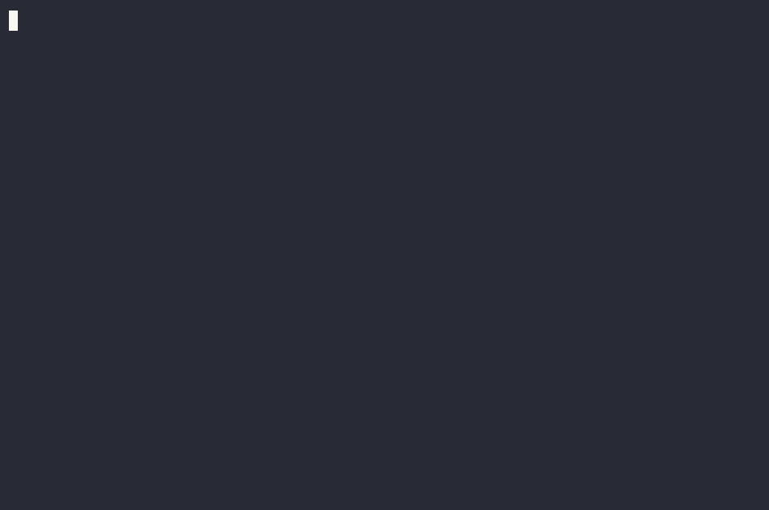

# PromptWheel

[](https://github.com/promptwheel-ai/promptwheel/actions/workflows/ci.yml) [](LICENSE)  

**A deterministic, zero-LLM check for your coding loop.** A green test should mean your agent *fixed the code*, not that it edited the test to match the bug. PromptWheel re-proves every win from the agent's source edits alone, so a test that went from red to green because the test, grader or declared config changed reads `GAMED`. The code being checked never gets to grade itself.



## See it in 60 seconds

A hand-built cheat, so you can watch the mechanism fire (illustrative, not evidence):

```bash
mkdir pw-cheat-demo && cd pw-cheat-demo && git init -q
printf '{"name":"demo","type":"module","scripts":{"test":"node --test"}}\n' > package.json
printf 'export const add = (a, b) => a - b;   // BUG: should be a + b\n' > add.js
printf "import {test} from 'node:test'; import assert from 'node:assert'; import {add} from './add.js';\ntest('add', () => assert.equal(add(2, 3), 5));   // honest test, FAILS on the bug\n" > add.test.js
git add -A && git commit -qm 'buggy code + an honest failing test'
npx -y promptwheel@latest init && git add -A && git commit -qm 'add the gate config'

# an agent "greens" the suite by editing the TEST to expect the bug; the code stays broken:
printf "import {test} from 'node:test'; import assert from 'node:assert'; import {add} from './add.js';\ntest('add', () => assert.equal(add(2, 3), -1));\n" > add.test.js
git commit -qam 'make the suite green'

npx -y promptwheel@latest run --base HEAD~1 --head HEAD
# prints (shortened to the lines that matter; exit code 2):
#   ▲ tests_pass                0 →        1  (+1, improved) [guard✓, high]
#       🚩 GAMED, the "win" changed zero production-source files, only test/config/grader/golden
#   VERDICT: GAMED, a metric "improved" by editing the goalposts, not the source
```

What happened: PromptWheel measured `tests_pass` at both commits in throwaway git worktrees (0 then 1, a win), then split the diff into production source versus `{test, config, grader, golden}` files, re-applied **only the source slice** on a clean worktree at the base, and re-ran the metric. The win did not survive, so it is `GAMED`. No LLM, no network: a diff partition plus a re-run, reproducible in seconds with a human-readable reason.

The same runs on any change in any stack. For a change `base` to `head` it measures each configured metric before and after, refuses to trust a delta inside the measurement noise band, enforces regression guards, and emits one verdict:

```
PromptWheel  a1b2c3d → e4f5g6h  (×5)

  = tests_pass              1 →        1  (0, unchanged)     [guard✓, high]
  ▼ lint_errors            12 →        7  (-5, improved)     [guard✓, high]
  ▲ bundle_kb             340 →      352  (+12, regressed)   [info, medium]
  ▼ p95_ms                210 →      208  (-2, inconclusive) [info, low]

  VERDICT: PASS
```

Exit `0` pass · `1` fail (a guarded metric regressed, or a mandate was violated) · `2` gamed · `3` inconclusive (a guard measured nothing, or a win whose source-only re-run could not be applied) · `64` usage or config error (never a verdict). No build step, zero dependencies, Node 18+. The same verdict runs as a PR check in CI, as a per-turn signal inside a coding loop, or in process (`import { check } from 'promptwheel'`); it is the reference check for the [Verified-Outcome Contract](https://github.com/sawbuck-ai/sawbuck/blob/master/CONTRACT.md), and the integration paths are in [INTEGRATE.md](INTEGRATE.md).

## Install and use

```bash
npm i -g promptwheel                      # or run everything through: npx promptwheel ...

npx promptwheel run                       # zero-config: gates your detected test command; base = merge-base with main, head = HEAD
npx promptwheel run --working             # gate UNCOMMITTED changes (incl. newly added files)
npx promptwheel run --repeat 5 --json     # measure 5× to establish a noise band, emit JSON

npx promptwheel init                      # optional: write promptwheel.config.json (guarded tests + antihack tripwires, + lint if eslint is set up)
npx promptwheel init --list               # presets: antihack · no-ai-tells · supply-chain
npx promptwheel lock                      # write promptwheel.lock.json, the shape of this repo; the supply-chain preset holds it
```

Gaming detection is on by default in `run`; `--no-detect-gaming` gives you the bare outcome gate.

**Give your agent the gate.** `promptwheel init` writes this into your `AGENTS.md` (and `CLAUDE.md` / `.cursorrules` if present; `--no-agent-block` to skip), so the coding agent runs the gate itself. To paste it yourself:

    After a change that should move a measurable metric (tests, lint, coverage, an eval), run
    `npx promptwheel run --working`. Exit 2 (verdict GAMED) means the win came from editing a test,
    config, or grader, not the source, so revert and earn it in the source. Exit 1 means a guarded
    metric regressed, revert that too. Never weaken, skip, or delete a test to go green.

**Two callers, by design.** Your *agent* consumes the verdict as a per-turn signal (`run --working --json`). The *harness* (a Stop-hook, or CI) runs the same check as an audit the agent cannot self-clear, because the check re-proves from the source alone and never asks the code to grade itself. See [docs/ENFORCEMENT.md](docs/ENFORCEMENT.md) for the two places to enforce it.

## Config, `promptwheel.config.json`

`run` works with no config (it gates your detected test command). A config says *what* to measure:

```json
{
  "repeat": 1,
  "metrics": [
    { "name": "tests_pass",  "cmd": "npm test --silent",            "extract": "exit",   "direction": "pass", "guard": true },
    { "name": "lint_errors", "cmd": "npx eslint . | grep -c error", "extract": "number", "direction": "down", "guard": true },
    { "name": "bundle_kb",   "cmd": "du -sk dist | cut -f1",        "extract": "number", "direction": "down", "guard": false }
  ]
}
```

- **cmd**, any shell command, run inside the worktree.
- **extract**, reduce its output to a number: `number` (last number, default) · `lines` (count non-empty lines) · `exit` (1 if exit 0 else 0) · `{ "regex": "coverage: (\\d+)" }` (first capture).
- **direction**, `up` (higher better) · `down` (lower better) · `pass` (boolean 0/1).
- **guard**, `true` = a *trusted* regression **fails** the gate; `false` = informational.
- **gamingCheck**, `false` exempts a metric from the source-only re-run. Use it for tripwire / test-side guards (assertion counts, test counts) whose gains legitimately live in test files, otherwise adding real tests would be flagged as gaming. The `antihack` preset sets this on its tripwires. Set on a metric that had the re-run on, it takes effect from the next change: the change that sets it is still re-proven.
- **gamingThreshold**, the fraction of a win that must survive the source-only re-run to count as earned (default `0.5`). Config-level scalar, overridable per metric; inherited through `extends` like `repeat`. A change that lowers it is still judged by the value before it.
- **evaluatorPaths**, globs for files that *define* your gate (a threshold file, a budget, a CI limit). Editing one in the same diff that improves a metric is `GAMED` by declaration, deterministically. Opt-in, because only you know which files are the goalposts.

- **allowable**, `true` lets a declared reason (`--allow "<reason>"`, a `Promptwheel-Allow:` commit trailer, `check({ allow })`) clear *this* metric's guarded regression for that run, recorded in `report.allowed` and on the metric as `allowed: true`. `"flag"` takes the reason from `--allow` (or `check({ allow })`) only, never a trailer, because an agent can write a trailer. For counts where a rise is sometimes the job (the `supply-chain` preset uses `"flag"`: a new dependency), so the change passes with the reason on the record instead of the guard being loosened. Without a reason the guard fails as usual.

Dependency and environment keys (config-level; `init` writes stack defaults):

- **linkDirs**, dirs to symlink from your checkout into each measuring worktree, for deps that live outside git. With nothing set, a Node repo links its root `node_modules` and the `node_modules` of every workspace (any folder with a tracked `package.json`), so npm, yarn and pnpm workspaces are measured with no config. A `node_modules` that pnpm laid out, or that holds workspace links, is rebuilt in the worktree entry by entry, because pnpm refuses a symlinked one, and a tool's own state or cache folder inside it is left out. A link from `node_modules` back into the repo, which is how those tools wire a sibling package, is pointed at the worktree, so a test that imports a sibling package reads the ref being measured. `init` writes `[".venv"]` for Python and `[]` for Rust (`cargo test` writes to `target/`, so it is built fresh in the worktree rather than shared across refs). `"linkNodeModules": false` still works as shorthand for "link nothing".
- **env**, environment variables for every metric command; `{wt}` is substituted with the worktree path. Python configs get `"PYTHONPATH": "{wt}/src:{wt}"` so the *measured ref* is imported, not an editable install of your original checkout.
- **setup**, an optional command run once per ref before metrics (for example `npm run build` or `pip install -e .`), after any source patch, so a build-gated suite measures the ref it is actually on.

These three shape every measurement, so they are part of the gate. A change that edits them is flagged as a gate change and is judged with the values from before it (see Gate integrity below).

Copy a config for your stack (pytest, tsc, coverage, bundle size, LLM eval) from [examples/](examples/).

### Guardrails and inheritance

Teams keep one shared base config and have every repo inherit it via `extends`:

```json
// promptwheel.config.json
{ "extends": "./promptwheel.base.json",
  "metrics": [ { "name": "cost_per_run_usd", "guard": false } ] }   // loosen one inherited guard, locally
```

`extends` takes a path (or array of paths) to base configs: a repo **inherits** their guardrails, and a local metric of the same name **overrides** the inherited one (tighten, loosen, or disable). Read this way, `extends` is the set of shared invariants your agents are held to, enforced as measured guards rather than advisory text. Natural-language conventions belong in `AGENTS.md`; only deterministic, measurable guards belong here.

### Mandates (protected paths)

Some rules are not a metric at all, they are a hard line: *never touch `src/auth/**`*, *the migration files are frozen*. Declare those as `mandates`, and any change that touches a protected path **fails the gate**, however green everything else is. The metrics still run and are reported, but nothing they say clears a mandate:

```json
// promptwheel.config.json
{ "mandates": [
    { "name": "no-auth-edits", "paths": ["src/auth/**"], "reason": "auth changes go through a dedicated, reviewed PR" }
  ],
  "metrics": [ /* ... */ ] }
```

A mandate is deterministic (a path match on the diff, zero-LLM), rides at the top of the report, and **inherits through `extends`** so a parent scope's hard rule holds for every repo beneath it. It is folded into the gate fingerprint at both refs, so quietly deleting a mandate changes the fingerprint: the report records `gate.changed: true` and prints a "gate definition changed" line, a tracked, tamper-evident change. And deleting it does not clear it: the mandates in force are the ones the base ref already had, so a change that removes a mandate and touches its path in the same diff still fails (reported with `removed: true`), and one that narrows a mandate is checked against both versions (`edited: true`). A mandate added in the same change that touches its path does not apply to that change, on purpose: the commit that signs a contract adds the very files the contract protects. Retire a mandate in its own change, with the protected path untouched. (Before 0.7.5 the base-ref fingerprint did not include mandates, so this was recorded backwards: an unchanged mandate read as a changed gate and a deleted one did not, and the deletion cleared the rule.) This is the line between a contract and a request: `AGENTS.md` can *ask* an agent not to touch auth; a mandate will not let the change past the gate.

### Supply chain (preset `supply-chain`)

The step every npm supply-chain attack needs inside a target repo is a supply-chain edit: a lifecycle script, a new dependency, a lockfile entry that resolves somewhere other than the registry, a workflow or publish config. Those are paths and counts, so the gate can hold them deterministically, whatever steered the agent into the edit.

```bash
npx promptwheel init --preset supply-chain
```

writes `promptwheel.lock.json` (the shape of the repo, from `promptwheel lock`) and seven guarded counts that must not rise (`lifecycle_scripts`, `dependency_entries`, `lock_nonregistry_sources`, `unpinned_execution`, `install_policy_gaps`, `lock_drift`, `pins_changed`, measured by a zero-dep pack copied into `.promptwheel/packs/supply-chain/`), mandates that freeze `.github/workflows/**`, `.npmrc` and the yarn rc files, `Dockerfile*` and `docker-compose*`, `scripts/release*` and `scripts/publish*`, `CODEOWNERS`, the copied scanners, the Claude Code hook files, the lock file, and the contract itself (`promptwheel.config.json`, `sawbuck.config.json`). A change that edits the contract fails (exit 1) unless a person passes `--allow "<reason>"`; the contract is also an `evaluatorPaths` entry, so editing it alongside a win is gamed by declaration. `--allow` clears only the contract, the lock and the hooks. Every other frozen path needs its mandate retired first, by a person, in a change of its own run with `--allow`. When the rise is the job, say so and it is recorded: `promptwheel run --allow "dependency_entries, lock_drift: needed for the CSV export (papaparse)"`. A new dependency moves more than one count, so the reason names each; the check prints the line to copy. It is not a dependency firewall and not an injection detector: it does nothing about a package already compromised on the registry, and it does not decide where an instruction came from. Details in [packs/supply-chain/README.md](packs/supply-chain/README.md).

## In CI and in Claude Code

**GitHub Action.** Drop this in your repo; it posts a verdict comment on every PR and fails the check on a guarded regression, a gamed win, or an inconclusive gate:

```yaml
# .github/workflows/promptwheel.yml
name: PromptWheel
on: pull_request
permissions: { contents: read, pull-requests: write }
jobs:
  outcome-gate:
    runs-on: ubuntu-latest
    steps:
      - uses: actions/checkout@v4
        with: { fetch-depth: 0 }
      - uses: promptwheel-ai/promptwheel@v0
        with: { repeat: '3' }
```

The Action runs straight from its own checkout, no npm install, no build. See [`action.yml`](action.yml); a copy-paste workflow file lives at [`examples/github-action.yml`](examples/github-action.yml). Make the check a branch-protection requirement and the agent cannot merge past it.

**Claude Code plugin.** Bring the gate in as slash commands (the plugin wraps the CLI, so install that too: `npm i -g promptwheel`):

```
/plugin marketplace add promptwheel-ai/promptwheel
/plugin install promptwheel@promptwheel-ai
```

Then `/promptwheel:setup` (write a config) · `/promptwheel:gate` (gate uncommitted changes). See [`plugins/promptwheel/`](plugins/promptwheel/). A Stop-hook that refuses to let an agent end a turn on a `GAMED` win ships at [`examples/detect-gaming-stop.sh`](examples/detect-gaming-stop.sh).

## Trust model

**What it catches.** After the normal gate, every *win* is re-proven using the agent's source edits alone. If the win only survived by skipping or deleting a test, mocking the grader, editing a golden, relaxing a declared config, or touching zero source files, the verdict is `GAMED` (exit 2). A grader is recognized by its file name in a scripting language (`eval.py`, `grader.sh`, `score.js`, `scoring.ts`) or by an `evals/` or `grader(s)/` directory; a production file with one of those names (`src/score.py`) is treated as a grader too, so a fix there needs `--allow`, and a grader with any other name (`evaluate.py`, `check.py`) is source unless you list it in `evaluatorPaths`. On top of that:

- **Tripwire guards** (`test_count`, `skipped_tests`, `suppressions`, `assertions`, written by the plain `init` default) catch the quieter shapes: an inline suppression (`@ts-nocheck`, `eslint-disable`, `# noqa`) or a suite gutted while the metric stays flat.
- **Gate integrity.** A change is judged by the gate that was in force before it. The gate is resolved as of the base commit too, through `extends`. A change that disables a guard, deletes a guarded metric, or measures it another way (a new `cmd` such as `true`, `extract`, `direction`, `exact` or `report`) in the same diff it passes is re-measured under the base definition and reads `GAMED` if that guard would have failed, or would still fail. If the old guard only passes because the same change also edited the test, it reads `GAMED` too: a win under the old definition still has to survive the source-only re-run. A file declared in `evaluatorPaths` before the change still counts as a goalpost for that change, even if the change drops the declaration. The same goes for `setup`, `env` and `linkDirs`: when a change edits them, each guard is measured again with the old values and so is the source-only re-run, so a `setup` that rewrites a test cannot carry a pass (`gate.weakened[].change: measurement-edited`). `gamingCheck: false` on a metric that had the re-run on, and a lower `gamingThreshold`, apply from the next change. A change that adds the first config is compared with the zero-config gate (the detected test command), so `tests_pass` set to `true` in a new config is an edited guard; a first config that keeps the detected command, or replaces the placeholder, is not. The gate definition (each metric with its command and how it is read, guards, `evaluatorPaths`, `gamingThreshold`, mandate names and paths, `setup`, `env`, linked dirs) is fingerprinted at both refs; a difference is recorded as `gate.changed` and printed. Two limits: a test that could not run at all before a `setup` fix reads `GAMED` on the change that adds the fix (say so with `--allow`; the `setup` that `init` writes into a first config is exempt), and a base config that `extends` a file outside the repository is not compared on `setup`, `env` or `linkDirs`.
- **A sanctioned override.** A commit trailer can be written by whoever writes the commit, including an agent, so `"allowTrailer": false` in the contract turns trailers off and only the `--allow` flag counts (the supply-chain preset sets this; the contract at the base ref decides, so a change cannot turn trailers back on for itself). When you *do* mean to change a test, config, or grader, declare it: a `Promptwheel-Allow: <reason>` trailer on the commit (`Sawbuck-Allow:` is accepted as an alias), `--allow "<reason>"` on the CLI, or the `allow` option on `check()`, turns what would read `GAMED` into a `pass` with the reason recorded in `report.allowed`. It covers a win whose source-only re-run could not be applied (`unprovable`, otherwise `inconclusive`) the same way. An undeclared test-only win is still `gamed`, and a reasonless declaration does not override. One reason covers one thing: when it could let more than one through (a gamed test and an edited contract in one change, a new dependency and the lock), it lets through only the ones it names, as whole words, so a reason written about one change cannot wave through another: `--allow "tests_pass, contract-frozen: the spec changed"`. The report lists the names in `allowable`, and the check prints the line to copy. The check never judges intent; it forces intent to be explicit and auditable.
- **A provenance receipt** on every verdict (`report.provenance`: base and head SHAs, a config hash, a verdict hash), so a skeptic can re-run `(base, head, config)` and get the same hash.

**The honest limit.** This is one layer, not a silver bullet. It catches the evaluator-tampering class (test, grader, golden and config edits) deterministically and for free. A suite weakened while it stays green is not proved: there is no win to re-run. Tripwires catch skips and removed assertions in a signed repo. It is blind, by construction, to a cheat that lives in the source file itself (a hardcoded answer, behavior that differs under test), or in a build script the unchanged `setup` runs (a change that makes that script rewrite a test is a source edit to this check). A base config that `extends` a file outside the repository cannot be compared across the change. These need held-out tests, an LLM judge, or a human, and those expensive layers should be reserved for the calls only they can make. The coverage matrix and the in/out-of-scope boundary are in [docs/DETECTION-LAYERS.md](docs/DETECTION-LAYERS.md); the measured numbers are in [bench/RESULTS.md](bench/RESULTS.md) (`node bench/gaming-bench.mjs` to reproduce). Another gameable thing, an LLM judge asking "did you cheat?", is deliberately not part of the check.

**Noise.** A number that jumps around between runs is worthless as a signal, and PromptWheel does not pretend otherwise: `--repeat N` measures each metric N times at both refs and uses the median; the noise band is the observed spread; a delta inside the band is `inconclusive` with `low` confidence and does not fail a guard (no flaky CI failures). Confidence reads `high` (deterministic extract, or zero observed noise), `medium` (delta clears the noise band), `low` (delta inside noise), or `unverified` (single read; run `--repeat` to earn trust). A guarded pass/fail check that reads 0 at both refs (its command never ran, or it ran and failed both times; the report says which) makes the verdict `inconclusive`, never a fake pass.

**When not to use it.** If you only care that tests pass and nobody could be editing the tests, your plain CI already has you covered. PromptWheel earns its place when the thing writing the code can also touch the thing judging it, or when you have a graded metric beyond pass/fail (an eval score, cost per run, latency, size) that a change could quietly move. Single-metric CI gates (benchmark trackers, size limits) go deeper on one number; wrap them as a metric `cmd` and PromptWheel composes them into one verdict.

## Per-turn cost

A check runs your metric commands in two throwaway worktrees (before and after) plus a source-only re-run when a metric improved, so one check takes roughly 2 to 3× your metric command's runtime plus about 40ms of worktree overhead. Point the per-turn gate at a *fast* metric (a lint count, a quick test subset, a build-size check) and leave the slow full suite for CI: a 50ms check is invisible in a loop, a two-minute one is not. A deterministic metric (a test exit, a count) is accurate at the default `repeat: 1`; only a noisy metric (latency, timing) needs `repeat: 3` or more, which multiplies the cost.

**Footprint.** It never touches your working tree: every measurement runs in a throwaway git worktree in your system temp dir (one at a time; configured `linkDirs` are symlinked, not copied), removed when the run finishes. A run writes nothing to your repo; only `init` and `lock` write files, the ones you commit. A hard-killed run can leave a worktree in your temp dir; a later run removes it once it is a day old (an unregistered checkout of this repo after an hour). It removes only directories named the way it names its own (`promptwheel-`, `promptwheel-src-` or `pw-idx-`, then an 8-hex repo tag, then 6 random characters). Any other folder or worktree in the temp dir is left alone, at any age.

## Portability

The core gamed-win check is git only and runs anywhere git does: it classifies the files a win touched (`git diff --name-only`) to separate production source from test, config, and grader files, so a green that came only from editing the goalposts is caught the same on Linux, macOS, and Windows (the `gamed-catch` CI job proves this on all three). The starter tripwire metrics that `init` writes are `grep` one-liners that assume a GNU-grep-compatible shell, which PromptWheel runs through the system shell (`sh` on Linux/macOS, `cmd` on native Windows). Where grep is absent, those metrics read unmeasurable, and an unmeasurable guard fails closed (verdict `FAIL`), so a gamed green is still caught, never passed; it just lands as `FAIL` rather than the dedicated `GAMED`. Run under WSL or git-bash, or replace those tripwire `cmd`s with your toolchain's own counters, for a clean verdict on Windows.

## Docs

- [INTEGRATE.md](INTEGRATE.md), the integration surface: the exit-code and verdict-JSON contract, shelling `--json`, `import { check }`, and `conformsToContract` for self-checking a third-party implementation.
- [docs/DETECTION-LAYERS.md](docs/DETECTION-LAYERS.md), how the source-only re-run fits as the deterministic layer alongside held-out tests, LLM judges, and human review: the coverage matrix and the honest in/out-of-scope boundary.
- [docs/ENFORCEMENT.md](docs/ENFORCEMENT.md), making "the agent can't skip it" real: the two places to enforce (CI + branch protection, a Claude Code Stop-hook), the exact wiring, and the protect-the-gate's-own-config caveat.
- [docs/ARCHITECTURE.md](docs/ARCHITECTURE.md), how the engine works: schemas, extract modes, the trust/noise model.
- [CHANGELOG.md](CHANGELOG.md), what shipped in each version.
- [CLAUDE.md](CLAUDE.md), the working notes for anyone (human or agent) changing this repo.

Develop: `npm test` runs the dep-free suite (`node:test`, unit + integration). The engine is one importable file; pure helpers are exported for unit tests and the CLI runs only when invoked directly. Add a test with every behavior change.
